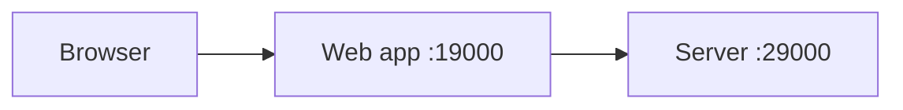

# Hangelo: the web application

**Less planning. More hanging out.**

Hangelo turns your friends' different schedules, budgets, interests and locations into one confirmed
plan. This repository is what people see in the browser; the server lives in
[meet_again](https://github.com/nuraskhan/meet_again), and its README tells what the product does.

Try it: https://meet-again-ui-112b5408b3d1.herokuapp.com/

## Watch the demo

[](https://www.youtube.com/watch?v=LBUlGUmj4EQ)

▶ [Watch the walk-through on YouTube](https://www.youtube.com/watch?v=LBUlGUmj4EQ). The same video plays
right on the [welcome page](https://meet-again-ui-112b5408b3d1.herokuapp.com/). To try the application,
create an account and open the link in the confirmation letter: until the e-mail is confirmed,
nothing else is open.



## Run it

You need Node 22.18 or newer, and the server running on http://localhost:29000 (`make start` in
`meet_again`).

```bash
npm install
```

```bash
npm run dev
```

Open http://localhost:19000 and log in as `alice@demo.test` with the password `demo123`
(run `make data` in `meet_again` first: it creates these people with a confirmed e-mail).

| Command | What it does |
|---------|--------------|
| `npm run dev` | The application with hot reload |
| `npm run build` | Type check and production build into `dist/` |
| `npm start` | Serves `dist/` the way Heroku does; needs `npm run build` first |

## Deployment

Heroku runs `npm start` (see `Procfile`), which is `server.js`: it serves the built application
and forwards `/api/*` to the server.

**hangelo.brainb.kz.** The application has an address of its own and lives at its root. The address
is a custom domain of the Heroku application; in the DNS of brainb.kz it is one `CNAME` record,
`hangelo`, pointing at the target Heroku names for that domain. On the server side,
`HANGELO_PUBLIC_URL` is `https://hangelo.brainb.kz`, so that links in letters lead there.
For one release (v0.2.0) the application lived under `/hangelo/`; such addresses are still led to
the same place without the path.

| Variable | Meaning | Default |
|----------|---------|---------|
| `PORT` | Where to listen; Heroku sets it | `19000` |
| `API_URL` | Address of the server | `http://localhost:29000` |

## More

- Design documents, page by page: [design](design).
